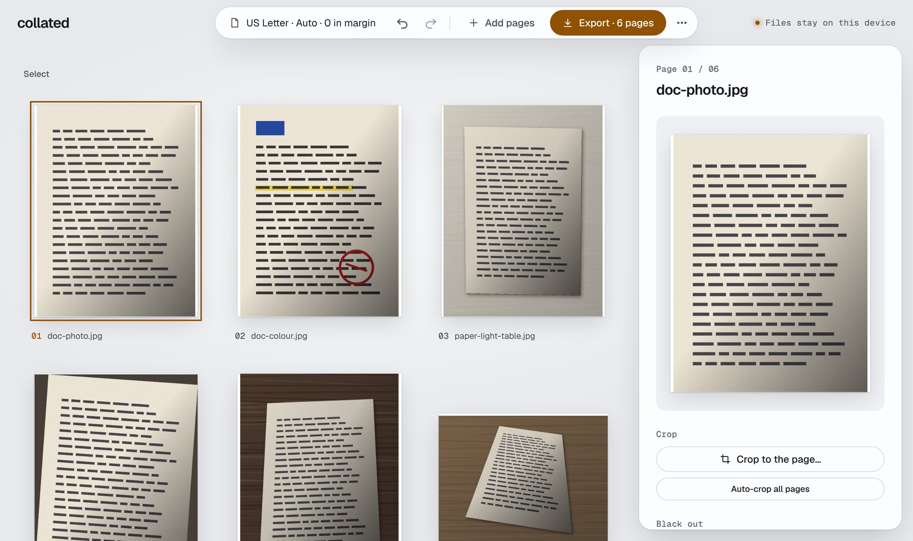

# Collated

**Turn a stack of scans or phone photos into one tidy PDF, right in your browser.**

Drop the images in, drag them into order, straighten and crop any page, pick a paper size, and export. Nothing is uploaded: there's no server, no account and no cookies.

[**Open Collated → collatedpdf.com**](https://collatedpdf.com/) · [User guide](https://collatedpdf.com/docs/) · [Changelog](CHANGELOG.md)

[](LICENSE)
[](https://collatedpdf.com/)
[](https://collatedpdf.com/privacy/)

<picture>
  <source media="(prefers-color-scheme: dark)" srcset="docs/images/workspace-dark.jpg">
  
</picture>

## Private by design

Your files never leave your device. Images are decoded, edited and assembled into a PDF locally, in a Web Worker. The only thing Collated counts is anonymous page views and exports. See the [privacy notice](https://collatedpdf.com/privacy/).

## Features

### The basics

- **Add pages** from JPG, PNG, HEIC, WebP, AVIF, GIF, BMP, TIFF and PDF files. Drag them in, pick files or paste, or take a photo on a phone.
- **Arrange** by dragging, touch or keyboard. Select several pages at once to duplicate or remove them, insert a blank page, reverse the order, or sort by name or date.
- **Fix a page:** rotate, straighten (automatically or by hand), scale, Fit or Fill, crop to the paper, and clean it up with Greyscale, Enhance or B&W filters.
- **Page setup:** Letter, A4 and other sizes, a custom size or Match image, orientation and margins. Defaults follow your locale.
- **Export** a PDF at High, Balanced or Small quality with a size estimate, a filename and title, and page numbers. Or save the pages as JPG or PNG.
- **Everyday comforts:** undo and redo, work kept across a reload, a print-resolution check, and light and dark themes.

### Advanced

- **Scanning:** a live camera scan that finds the page and shoots on its own, auto-crop for every photo, interleaved fronts and backs for two-sided scans, blank-page removal, and auto-rotate by reading the text.
- **Fill and sign:** draw, type or photograph a signature, and keep it on the device if you like. Add text, dates, ticks and crosses to forms that have no fields.
- **Privacy and security:** real redaction that removes what's under the box, a watermark that can be burned in, AES-256 passwords, and opening password-protected PDFs.
- **Searchable text (OCR):** 23 languages in the Latin, Greek and Cyrillic alphabets, recognised on the device.
- **Layout:** 2 or 4 pages per sheet, ID card front and back at real size, and booklet and poster printing with cut marks.
- **Document structure:** bookmarks by section or one per imported file, splitting into several PDFs by range or every N pages, exporting only selected pages, a file size limit, and shrinking existing PDFs.
- **Archiving:** PDF/A-2b output, checked with veraPDF.
- **Install as an app:** works offline, appears in the share sheet, and opens PDFs and images from the desktop.

Jumping straight to one job? There are task pages for [JPG to PDF](https://collatedpdf.com/jpg-to-pdf/), [Merge PDF](https://collatedpdf.com/merge-pdf/), [Scan to PDF](https://collatedpdf.com/scan-to-pdf/), [Sign a PDF](https://collatedpdf.com/sign-pdf/), [Compress a PDF](https://collatedpdf.com/compress-pdf/) and [HEIC to PDF](https://collatedpdf.com/heic-to-pdf/).

## Development

Requires Node 22+.

```sh
npm install
npm run dev            # http://localhost:5173/
npm run check          # prettier --check, eslint, tsc, vitest
npm run build          # hosting:check, tsc, vite build → dist
npm run verify         # real-browser E2E against the build (needs Playwright's Chromium)
```

`npm run verify` serves the build with the production headers from `vercel.json` and drives the app in Chromium: it imports a mixed batch, reorders by keyboard, rotates, undoes and exports. It fails on any console error, CSP violation or axe WCAG 2.2 AA violation, and saves screenshots to `shots/`. Install a browser once with `npx playwright install chromium`, or point `CHROME_PATH` at an existing Chromium.

Some PDF tests render the output with poppler's `pdftoppm`, and are skipped if it isn't installed (`apt install poppler-utils` or `brew install poppler`). CI installs it.

### Layout

```
src/core/      pure, framework-free: model, page sizes, geometry, reducer + undo, image headers, PDF build
src/import/    browser decoding, thumbnails, the out-of-state byte store
src/export/    the export worker and its client
src/state/     React hooks and settings persistence
src/components UI
scripts/       hosting:check, verify
tests/         fixtures (with the script that generates them) and helpers
```

### How it works

[design_notes.md](design_notes.md) explains how Collated is built: one layout function shared by the preview and the PDF, keeping scans and PDF pages untouched, the image filters and paper detection, OCR, and the strict CSP. Each decision has a short record in [`docs/adr/`](docs/adr/).

## Hosting

Collated is a static site on Vercel, served from the root of its own origin, [collatedpdf.com](https://collatedpdf.com/). It owns its security headers in `vercel.json`. The old address, `mattblack.space/tools/collated/…`, redirects permanently to the same path here.

## Contributing

Issues and pull requests are welcome. See [CONTRIBUTING.md](CONTRIBUTING.md).

## Licence

[MIT](LICENSE) © Matt Black. Bundled libraries and their licences, including libheif (LGPL-3.0, loaded as a separate replaceable file), are listed in [THIRD-PARTY-NOTICES.md](THIRD-PARTY-NOTICES.md). The built site carries it and the licence texts under `licenses/`.
